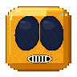

<div align="center">

# 🤖 Rusty Desk

### Tu pequeño compañero de escritorio. Con píxeles, carácter y alguna que otra cara de sueño.

**Un asistente de escritorio hecho en Rust, con alma de videojuego de 16 bits.**




</div>

---

Rusty no quiere ser otra ventana que abrís, usás y olvidás. Quiere acompañarte mientras trabajás: te ayuda a organizar tareas, concentrarte, escuchar música y conversar con modelos de IA. Y, de vez en cuando, **te mira de reojo, cabecea o reacciona si lo molestás**.

Tiene una estética retro de 16 bits, un marco de acero oxidado y tres formas de vivir en tu escritorio.

## 🕹️ Tres formas de tener a Rusty cerca

| Modo | Qué hace |
| --- | --- |
| **Ventana principal** | Todas las herramientas, el chat y la configuración. |
| **Isla** | Vista compacta para consultar el estado, controlar el enfoque y acceder a la música. |
| **Notch** | Se esconde contra el borde de la pantalla y deja a Rusty asomándose; puede reaparecer al pasar el mouse, si activás esa opción. |

Los marcos se dibujan con una **textura 9-slice**: las esquinas pixeladas no se estiran y los bordes acompañan el tamaño de cada modo.

## ✨ Qué podés hacer

- **💬 Charlar con IA.** Configurá un proveedor OpenAI-compatible o Gemini. También podés usar un modelo local mediante [LM Studio](https://lmstudio.ai/), sin depender de una API de pago.
- **📝 Organizar tareas y hábitos.** Creá, completá y seguí tus pendientes; registrá hábitos cotidianos.
- **⏳ Entrar en foco.** Temporizador Pomodoro, pausas y tareas vinculadas a las sesiones de concentración.
- **🎵 Escuchar música.** Reproducción de URLs de audio y listas `.m3u` / `.m3u8`, con controles también en la isla. La disponibilidad de formatos y controles depende del sistema.
- **🗂️ Ordenar archivos.** Herramientas de organización del escritorio y conversión a Markdown.
- **🔎 Consultar información.** Integraciones opcionales para búsqueda web, lectura de páginas, clima y tipos de cambio.
- **🧠 Dreaming (experimental).** Un modelo configurable, independiente del asistente principal, puede analizar historial de conversaciones y generar recuerdos almacenados localmente en SQLite. Está desactivado de forma predeterminada y requiere configuración explícita.
- **🤖 Ver a Rusty reaccionar.** Animaciones de mirada, movimiento, sueño, alegría, errores, reconexiones y clics repetidos, sin consumir tokens para animarse.

> **Privacidad:** las tareas, conversaciones y datos persistidos se guardan localmente en SQLite. Si habilitás una IA o herramienta remota, las solicitudes correspondientes sí pueden salir de tu computadora. Dreaming no envía historial a servicios remotos salvo que lo autorices expresamente.

## 🚀 Ejecutarlo

### Requisitos

- [Rust y Cargo](https://rustup.rs/) instalados.
- Windows o Linux con entorno de escritorio compatible.
- Conexión a Internet solo para descargar dependencias y utilizar proveedores en línea; un servidor local de IA es opcional.

```bash
git clone https://github.com/gustavololli/rusty-desk.git
cd rusty-desk
cargo run --release
```

Para desarrollar o ejecutar pruebas:

```bash
cargo fmt --check
cargo test
cargo check
```

> **Estado del proyecto:** desarrollo activo (v0.3.0). Las funciones de integración con el sistema operativo pueden comportarse de manera distinta en Windows y Linux. Si algo falla, abrí un issue con el sistema, la versión y los pasos para reproducirlo.

### Conectar LM Studio (ejemplo)

1. Abrí LM Studio, cargá un modelo y activá su servidor local.
2. En la configuración de Rusty, seleccioná el proveedor **OpenAI-compatible**.
3. Indicá la URL base `http://127.0.0.1:1234/v1`.
4. Elegí el identificador exacto del modelo que tenés cargado.

El endpoint de chat utilizado es `/v1/chat/completions`. No necesitás una clave real para un servidor local que no exige autenticación.

### Dreaming: memoria separada

La idea es simple: **el modelo que conversa no tiene que procesar sus propios recuerdos**. Podés asignar un modelo diferente, local o por API, para el proceso Dreaming. La memoria se guarda en SQLite y el asistente puede recuperar contexto relevante cuando corresponde.

Dreaming es opcional; si lo desactivás, el resto de Rusty sigue funcionando.

## ⌨️ Algunos comandos

Escribí `/ayuda` dentro del chat para consultar la lista completa.

| Comando | Acción |
| --- | --- |
| `/tarea Preparar presentación` | Crea una tarea. |
| `/tareas` | Muestra las tareas. |
| `/pomodoro 25` | Inicia un bloque de concentración. |
| `/pausa` | Pausa el Pomodoro. |
| `/agua` | Registra agua. |
| `/clima Córdoba` | Consulta el clima. |
| `/buscar Rust egui` | Busca en la web, si configuraste un proveedor. |

## 🧱 Cómo está armado

```text
src/
├── ui/            # egui, isla, notch, mascota, sprites y marcos 9-slice
├── ai/            # Proveedores de modelos
├── dreaming.rs    # Procesamiento independiente de memoria
├── persistence/   # SQLite local
├── platform.rs    # Integraciones según sistema operativo
├── music.rs       # Reproducción y controles
├── tools/         # Comandos y herramientas
└── main.rs        # Arranque de la aplicación

assets/
├── rusty-16bit/   # Sprites y animaciones de Rusty
└── frames/        # Marco pixelado 9-slice
```

Rusty está construido sobre **Rust + egui/eframe**, con **SQLite** para persistencia. La interfaz y las animaciones son locales: no necesitan una conexión a IA para moverse.

## 🧪 Contribuir

¿Encontraste un bug, querés aportar un sprite o mejorar el soporte para tu sistema operativo? Los [issues](https://github.com/gustavololli/rusty-desk/issues) y pull requests son bienvenidos.

Antes de enviar cambios, ejecutá `cargo fmt --check`, `cargo test` y `cargo check` en tu plataforma. No incluyas claves de API ni datos privados de tu base local.

---

<div align="center">

**Hecho con Rust, café y cariño por los videojuegos viejos.** 🧡

*Rusty puede dormirse. Tus ideas, no.*

</div>
